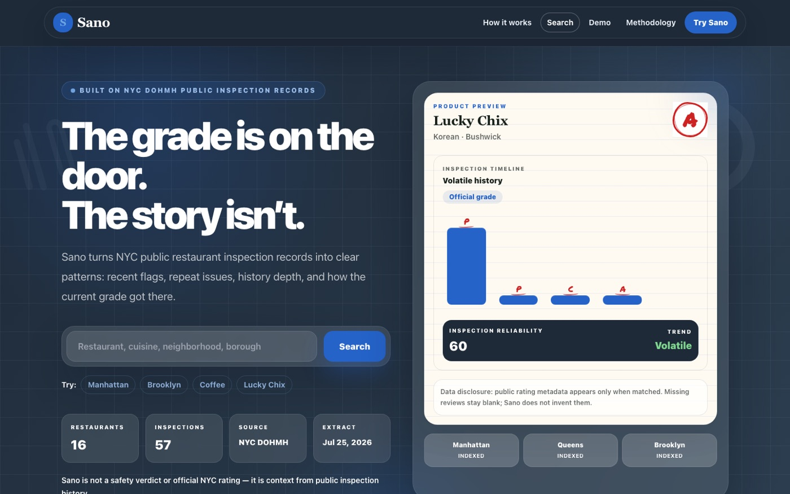
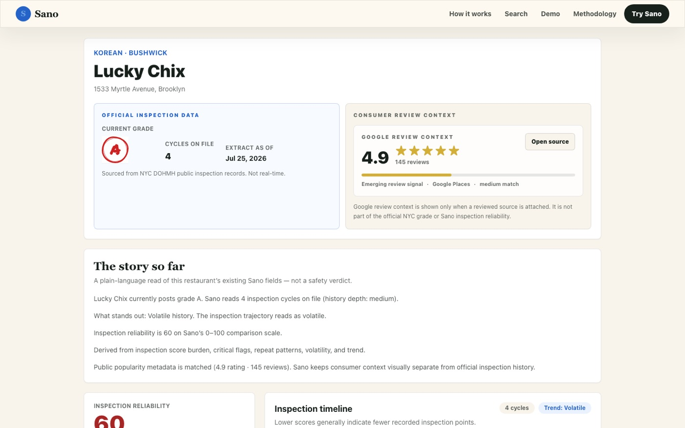

# Sano

**The grade is on the door. The story isn't.**

Sano turns New York City's public restaurant inspection records into clear context. A posted letter grade is one snapshot; the city's raw inspection data is too dense to read quickly. Sano keeps the official grade first, then adds plain-language signals: recent critical flags, repeat issues, how deep the inspection history goes, and whether a record is steady or volatile.

**Live demo:** https://sano-nine.vercel.app



## What it does

- Search restaurants by name, cuisine, neighborhood, or borough, and filter by trajectory, confidence, and recent critical flags.
- Restaurant profiles with the official NYC DOHMH grade, an inspection timeline, an inspection reliability score, and a plain-language "story so far."
- A methodology page that explains how every derived signal is calculated and what Sano cannot tell you.
- Official data stays visually separate from any consumer review context.



## Scope and honesty

Sano is decision support, not a safety verdict or an official NYC rating. The live demo indexes a small, clearly disclosed extract of NYC DOHMH inspection records (16 restaurants and 57 inspections as of the July 2026 extract). Coverage is not citywide.

## Accessibility

The core journey (search, results, profile, methodology) was audited and fixed for keyboard use, focus visibility, contrast, and screen-reader announcements. The checks that can be automated are repeatable scripts:

```bash
npm run a11y:contrast     # contrast ratios for audited design tokens
npm run a11y:regression   # focus, live-region, and debounce checks
```

Audit notes and screenshots are in [docs/accessibility-audit](docs/accessibility-audit).

## Tech stack

Next.js 14, React 18, TypeScript, Tailwind CSS, Python data scripts (ingest and scoring), an optional Supabase data layer with a committed-JSON fallback, deployed on Vercel.

## Run locally

```bash
npm install
npm run dev        # http://localhost:3000
npm run check      # validate data, lint, accessibility checks, and build
```

Data preparation scripts live in [scripts](scripts) (`ingest_nyc_dohmh.py`, `score_restaurants.py`).

## Documentation

- [Product requirements](docs/PRD.md) and [architecture](docs/ARCHITECTURE.md)
- [Data plan](docs/DATA_PLAN.md) and [API](docs/API.md)
- [Original project brief](docs/PROJECT_BRIEF.md) (planning archive)

## License

See [LICENSE](LICENSE).
