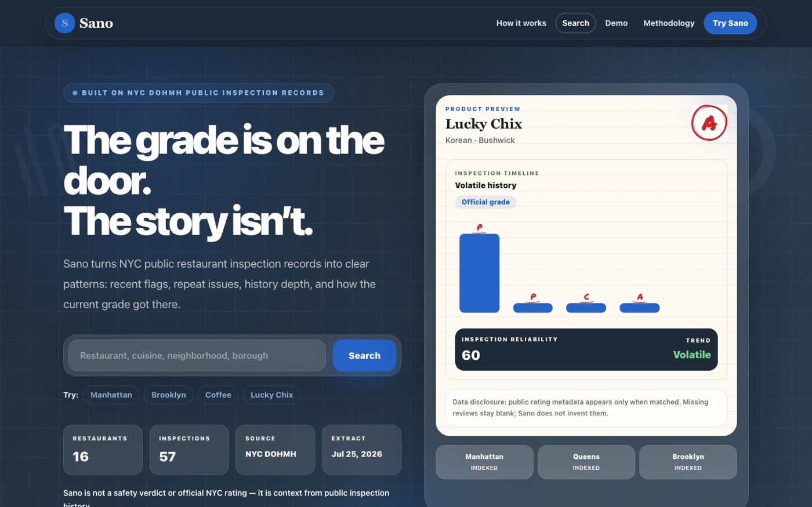
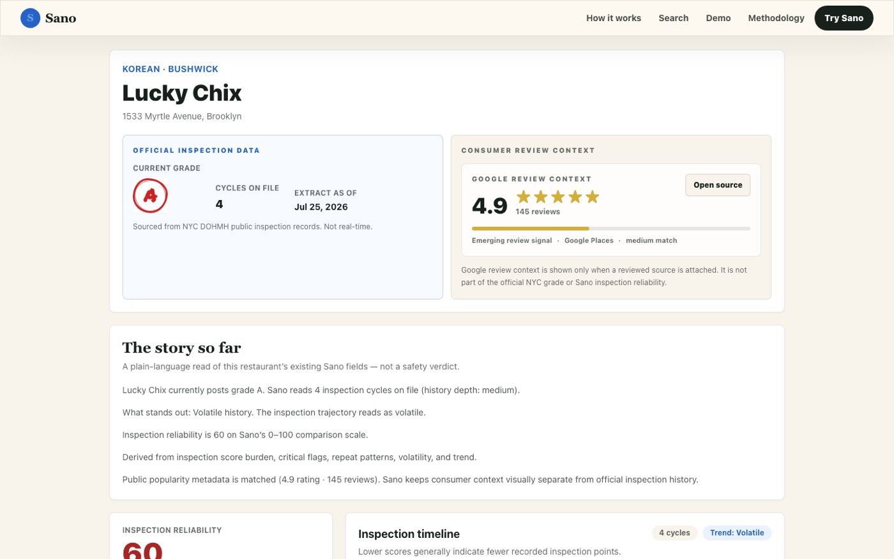
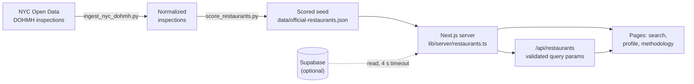

# Sano


## Try the live demo

[Open the Lucky Chix demo](https://sano-nine.vercel.app/restaurants/50169790) and scroll to **Inspection timeline**. The July 25, 2026 extract shows a C on March 16 and an A on May 27. Compare those official grades with Sano’s separate **Volatile** trajectory label, which summarizes four inspection cycles.

**The grade is on the door. The story isn't.** Sano turns New York City's public restaurant inspection records into plain-language context next to the official letter grade.

**Live demo:** https://sano-nine.vercel.app

[](https://github.com/Nicolercc/Sano/actions/workflows/ci.yml)



## Try it in a minute: Lucky Chix

1. **Open [Lucky Chix](https://sano-nine.vercel.app/restaurants/50169790)** (Korean, Bushwick). The official grade on the door is **A**.
2. **Read the inspection timeline.** The posted grades went from **C on Mar 16, 2026 to A on May 27, 2026**. The two earlier cycles were still grade-pending, and the first one (Feb 19, raw score 41) had 2 critical flags. This extract shows no repeat pattern for Lucky Chix.
3. **Check the number.** The jump from 41 to 2 makes the trajectory *volatile*, and the reliability score is **60**. The [methodology page](https://sano-nine.vercel.app/methodology) uses this restaurant as its worked example: 100 − 1.7 × 11.25 − 0.6 × 2 − 2 × 4 − 12 = 59.7, rounded to 60.


## The problem

A posted letter grade is one snapshot. Behind it, NYC DOHMH publishes every inspection: scores, violation codes and critical flags. That data is public but too dense to read at a glance. Sano keeps the official grade first, then shows what the history says: recent critical flags, repeated violations, how much history there is, and whether the record is steady, improving or volatile.

Sano is decision support, not a safety verdict or an official NYC rating. The live demo indexes a small, disclosed extract: **16 restaurants and 57 inspections from the July 2026 extract**. Coverage is not citywide.



## How it works



1. **Ingest:** a Python script pulls inspection rows from NYC Open Data and groups them by restaurant.
2. **Score:** `scripts/score_restaurants.py` computes every derived field (reliability score, trajectory, confidence, label) from the inspection history alone. The committed seed is its output.
3. **Serve:** the Next.js app reads the seed, or Supabase if configured, falling back to the seed on any error or timeout. Consumer metadata (ratings, price) is shown only when a real source backs it.
4. **Explain:** the [methodology page](https://sano-nine.vercel.app/methodology) publishes the exact formula, thresholds, label order and a worked example.

## Key engineering decisions

- **One scorer, in Python, with the output committed.** All scoring happens offline in one place, and the app only displays it. *Tradeoff:* changing a rule means rescoring the seed (`--rescore-seed`). *Why:* the UI can never show a number the methodology can't reproduce, and a seed-integrity test fails if they drift.
- **Rules, not a model.** The reliability score is a published formula, not machine learning. *Tradeoff:* it's blunter, and a long troubled history can score 0 while the door shows an A. *Why:* every number can be explained to a diner, and the page says so.
- **Official and consumer data never mix.** Inspection signals and review metadata are kept in separate fields, and the API returns `null` for anything without a backing source. *Tradeoff:* the official-only demo shows no ratings at all. *Why:* the official record's credibility is the product.
- **Graceful degradation.** Supabase is optional and every read falls back to the committed seed. *Tradeoff:* a Supabase outage quietly serves the July extract. *Why:* the demo can't break on a third-party service, and `/api/health` reports which data mode is live.
- **Accessibility as a gate.** Contrast and focus/live-region checks run in CI, backed by a manual audit. *Why:* the core journey (search → results → profile) has to work by keyboard and screen reader.

## Testing and quality

| Check | Command | What it covers |
|---|---|---|
| Scoring rules (17 tests) | `npm run test:scoring` | Repeat patterns, trajectory, reliability formula (incl. the methodology worked example), confidence, label order, seed integrity |
| App logic (19 tests) | `npx vitest run` | TS/Python trajectory parity against every seeded restaurant, API param validation, Supabase query quoting |
| Data validation | `npm run validate:official` | Seed schema and value ranges |
| Accessibility | `npm run a11y` | Contrast ratios for design tokens; focus, live-region and debounce regressions |
| Lint / types / build | `npm run lint`, `npm run typecheck`, `npm run build` | ESLint (Next core-web-vitals + TypeScript), strict TypeScript, production build |

`npm run check` runs all of it, and CI runs it on every pull request. Accessibility audit notes and screenshots are in [docs/accessibility-audit](docs/accessibility-audit).

## Run locally

Requires Node 20.9+ and Python 3.10+.

```bash
npm install
npm run dev        # http://localhost:3000
npm run check      # validate data, lint, typecheck, test, a11y, build
```

No environment variables are needed: the app serves the committed extract. Optional Supabase and Google Places settings are documented in [.env.example](.env.example). Data preparation scripts are in [scripts](scripts).

## Limitations and next steps

- **Small extract.** 16 restaurants, chosen for a varied demo, not a random sample. A larger load (up to 1,000 restaurants) is supported through the Supabase scripts but isn't deployed.
- **Score calibration.** 6 of the 16 restaurants score 0, because penalties for critical flags add up across the whole history with no time decay. Recency weighting is the next scoring change.
- **Point-in-time data.** The extract is from July 2026 and isn't synced live. `/api/health` reports `dataAsOf`.
- **No usability testing yet** with diners. The accessibility audit was done by the author.

More: [architecture](docs/ARCHITECTURE.md) · [data plan](docs/DATA_PLAN.md) · [API](docs/API.md) · [product requirements](docs/PRD.md) · [planning archive](docs/archive)

## License

MIT, see [LICENSE](LICENSE).
